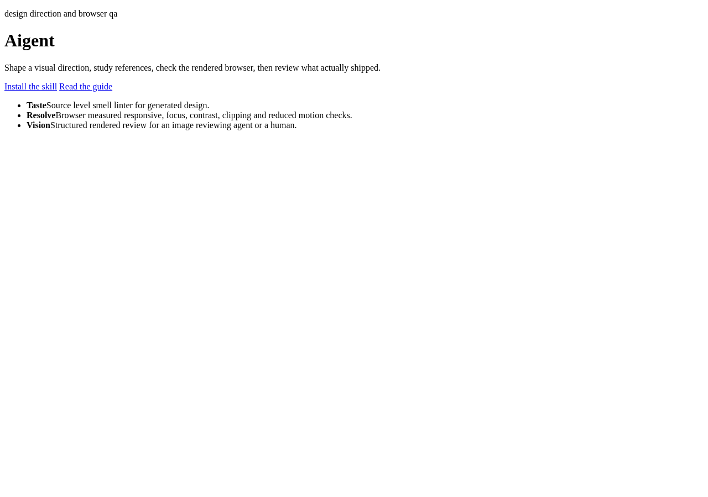
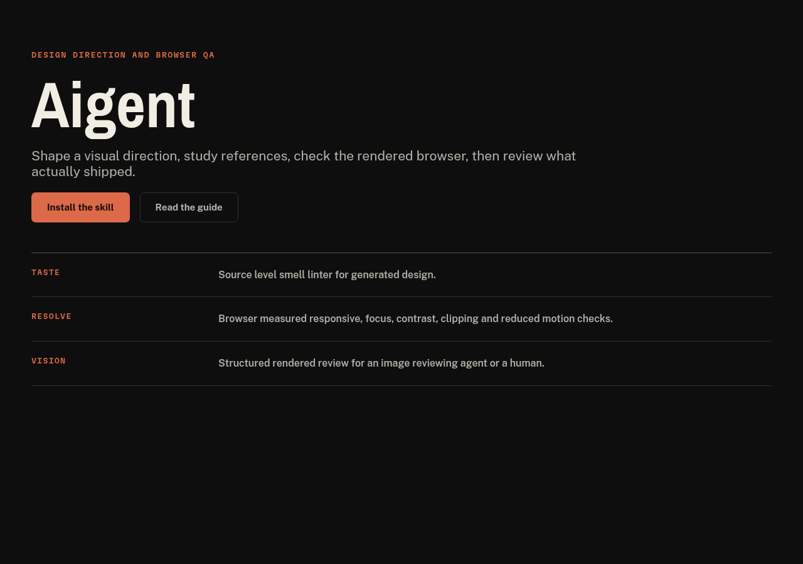

# Aigent

**a design skill that makes your agent pick a direction, build it, then actually look at the result in a browser.**

Design direction and browser QA for Claude Code, plus cursor and codex. one `SKILL.md` at the root, real guidance in `skills/aigent-design/`.

| plain html | same html with aigent `tokens/system.css` |
|---|---|
|  |  |

same markup in both. the right side only links `tokens/system.css` and uses its `ds-*` classes and tokens (source in [`docs/before-after/`](docs/before-after/)). it shows the neutral token layer, not a full skill run. web fonts are not loaded, so the display face falls back to the stack in the tokens.

## quick install

**claude code**, every project:

```bash
git clone https://github.com/wrg32786/aigent-design-system ~/.claude/skills/aigent
```

or per project with the bundled installer (writes `.claude/skills/aigent-design/`, see below):

```bash
npx --yes --allow-git=all github:wrg32786/aigent-design-system install
```

then just ask: `use aigent to redesign this landing page`.

**cursor**: clone the repo somewhere in or next to your project, then add `.cursor/rules/aigent.mdc`:

```md
---
description: design, redesign, polish or review frontend UI
alwaysApply: false
---
For design work, read and follow path/to/aigent-design-system/SKILL.md.
```

if your cursor build has agent skills turned on, you can drop the clone into `.cursor/skills/aigent` instead.

**codex**: clone the repo (for example to `~/.agents/skills/aigent` or into your project), then add this to your project's `AGENTS.md`:

```md
## design work
For any design, redesign, polish or UI review task, read and follow
path/to/aigent/SKILL.md before writing frontend code.
```

the browser backed commands (Taste, Resolve, Vision) need Node and run through `npx` in every tool. `setup-browser` installs Chromium for them.

## start a new site

one command scaffolds an Astro site that is already wired to the rules (Node 22.23+):

```bash
npx --yes --allow-git=all github:wrg32786/aigent-design-system create-site my-site
cd my-site && npm run dev
```

from a clone of this repo: `npm run create-site -- my-site` or `node scripts/create-site.mjs my-site`.

you get the design tokens and four themes (graphite by default), a small section kit (hero, proof rows, one scroll story, closing action), one GSAP scroll timeline with reduced-motion and mobile handling, the Aigent skills under `.claude/skills/`, and an `AGENTS.md` + `CLAUDE.md` + cursor rule telling the agent to load them and run `npm run gates` (build plus the copy and design linter) before shipping. deploys go through the publish-site skill.

options: `--theme graphite|ember|cobalt|paper`, `--with-remotion` (adds an isolated Remotion hero-loop project, off until you render it), `--no-install`, `--force`. GSAP and Remotion come from npm under their own licenses, not MIT; see [`templates/agent-site-starter/README.md`](templates/agent-site-starter/README.md) and [`THIRD_PARTY.md`](THIRD_PARTY.md). the vendors' own agent skills are optional extras: `npx skills add https://github.com/greensock/gsap-skills` and `npx skills add remotion-dev/skills`.


Aigent installs a focused design skill into an existing repo while Claude Code remains the interface. It helps shape visual direction, study references, choose layout/type/motion/media, inspect the rendered browser, and run structured design review without replacing the project's own product or brand authority.

Aigent is in active beta. The strongest shipped pieces today are the core design skill, Inspiration Intelligence, Resolve, and the structured Vision review protocol.

## Full install (claude code, per project)

From the repo you want to design:

```bash
npx --yes --allow-git=all github:wrg32786/aigent-design-system install
npx --yes --allow-git=all github:wrg32786/aigent-design-system init
npx --yes --allow-git=all github:wrg32786/aigent-design-system setup-browser
npx --yes --allow-git=all github:wrg32786/aigent-design-system doctor
claude
```

npm 12 blocks Git-backed package execution by default; `--allow-git=all` explicitly authorizes this GitHub repository for the command. Older npm versions may ignore the setting with a warning.

Then say:

```text
Use Aigent to help me redesign this site.
```

`install` writes vendor-owned skill files under `.claude/skills/aigent-design/` and records their hashes in `.aigent/install.json`. It does **not** replace root `PRODUCT.md`, `DESIGN.md`, brand docs, application source, or package configuration.

`init` creates `.aigent/project-context.md` only when you want an Aigent-specific project brief. Existing project authority remains authoritative.

`setup-browser` installs Chromium for browser-backed capture and QA.

## What it does

Aigent can:

- inspect the existing repo before proposing a redesign
- help shape a vague brief without turning the process into a questionnaire
- develop multiple visual directions before a large greenfield commitment
- persist an approved direction in `.aigent/design-direction.md`
- preserve unrelated approved work during scoped revisions
- study public references and convert evidence into Design DNA
- synthesize multiple references instead of cloning one source
- choose layout, typography, color, motion, media, and interface direction
- flag common generated-design smells with Aigent Taste, including filler words, stock lines, and scroll cues in page copy
- plan scroll stories around a feeling curve and one peak, pick a page grammar and scroll devices on purpose, and verify scroll pages by sampling inside each section (`skills/aigent-design/reference/scroll.md`)
- write copy from a fact sheet and a voice card instead of swapping slop words for synonyms (`skills/aigent-design/reference/copy.md`)
- review a finished page in Floor, Reflex, and Finish tiers with fresh-context hero and finish reviews (`skills/aigent-design/reference/gates.md`)
- structure business sites around visitor questions and real proof, keep forms, URLs, and analytics intact through a redesign, and run a release audit (`skills/aigent-business-sites`)
- run browser-measured responsive, focus, contrast, clipping, reduced-motion, and runtime checks with Resolve
- prepare a structured rendered-review task with Vision
- export and deploy static work through constrained publishing tooling

Aigent does **not** contain a magical visual model of its own. Vision is a review protocol for a capable image-reviewing agent or human. Taste is a source-level smell linter. Design Intelligence is a deterministic planner. Those boundaries are deliberate.

## Normal workflow

```text
SHAPE → DIRECT → BUILD → TASTE → RESOLVE → SEE → POLISH
```

References add an optional inspiration loop before direction is locked.

Aigent keeps three lightweight controls behind the scenes:

```text
VARIANCE  familiar ↔ unconventional
MOTION    static ↔ motion-led
DENSITY   sparse ↔ information-dense
```

Once you approve a direction, later work reads that authority instead of improvising a new visual world on every page.

## Browser-backed commands

```bash
npx --yes --allow-git=all github:wrg32786/aigent-design-system taste .

npx --yes --allow-git=all github:wrg32786/aigent-design-system inspire add https://example.com

npx --yes --allow-git=all github:wrg32786/aigent-design-system resolve --init --target .
npx --yes --allow-git=all github:wrg32786/aigent-design-system resolve --target . --url http://127.0.0.1:3000

npx --yes --allow-git=all github:wrg32786/aigent-design-system vision prepare --target . --url http://127.0.0.1:3000
```

Private, loopback, local-network, and common metadata URLs are denied by Inspiration Intelligence unless `--allow-private` is explicitly supplied.

## Update and uninstall

Run the install command again to update vendor-owned files:

```bash
npx --yes --allow-git=all github:wrg32786/aigent-design-system install
```

Aigent tracks installed file hashes. Files you modified are preserved rather than overwritten silently. Obsolete untouched vendor files can be removed during update.

To remove Aigent-owned skill files:

```bash
npx --yes --allow-git=all github:wrg32786/aigent-design-system uninstall
```

Modified installed files are preserved and reported.

## Examples

The repository includes canonical examples for:

- an Astro site starter for agents (`templates/agent-site-starter`, scaffolded with `create-site`)
- modular editorial/product pages
- guided sales decks
- command-center interfaces
- progressive Three.js product stages
- inspiration analysis and synthesis
- the Site Library case study: fictional brand sites built to these rules, and the lessons their review rounds added (`case-studies/site-library`)

These are implementation examples, not evidence that Aigent automatically outperforms every baseline or competing skill. Comparative no-skill/Impeccable/Aigent evaluations and broader before/after case studies remain part of the validation roadmap.

## For contributors

```bash
npm install
npm run check
npm run taste:check
npm run registry
npm run intelligence
npm run inspiration
npm run resolve:check
npm run vision:check
npm run publish:check
npm run starter:check
npm run eval
```

The public install path should also be exercised in a clean consumer fixture before release.

## License

MIT for Aigent-authored code and documentation. `skills/aigent-business-sites/` is adapted from [Ultra Web Design](https://github.com/wrg32786/Ultra-web-design) under Apache-2.0; see its [`NOTICE.md`](skills/aigent-business-sites/NOTICE.md). The site starter installs GSAP and the optional Remotion project from npm under their own non-MIT licenses. Third-party tools and assets retain their own licenses; see [`THIRD_PARTY.md`](THIRD_PARTY.md).

## Credits

The scroll, copy, and review-gate references adapt ideas from [scroll-craft](https://github.com/nateherkai/scroll-craft), [taste-skill](https://github.com/leonxlnx/taste-skill), and [Hallmark](https://github.com/nutlope/hallmark), all MIT. The business-sites skill adapts [Ultra Web Design](https://github.com/wrg32786/Ultra-web-design) (Apache-2.0). Details in [`THIRD_PARTY.md`](THIRD_PARTY.md) and [`skills/aigent-design/NOTICE.md`](skills/aigent-design/NOTICE.md).
