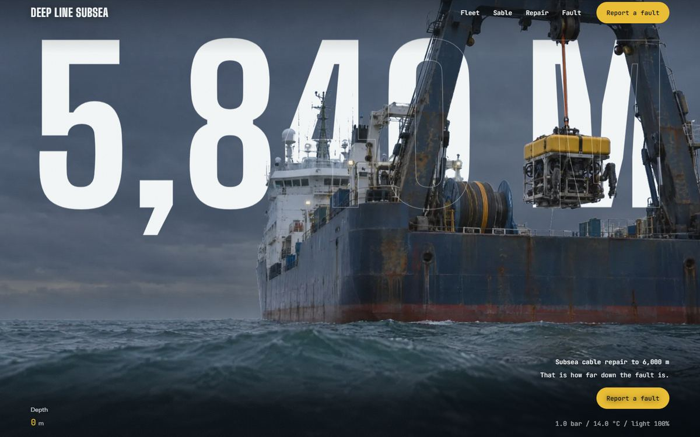
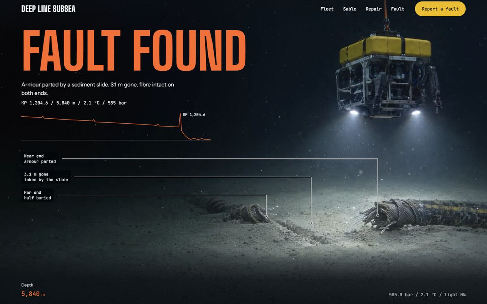
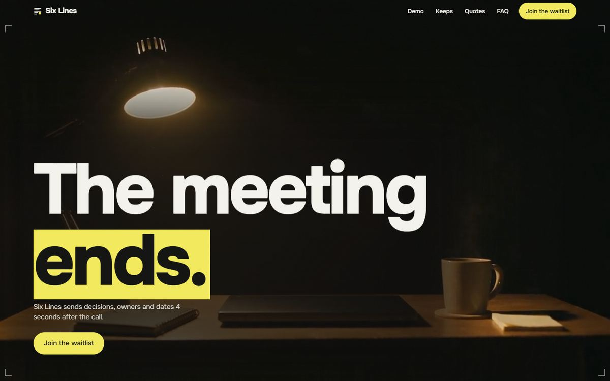
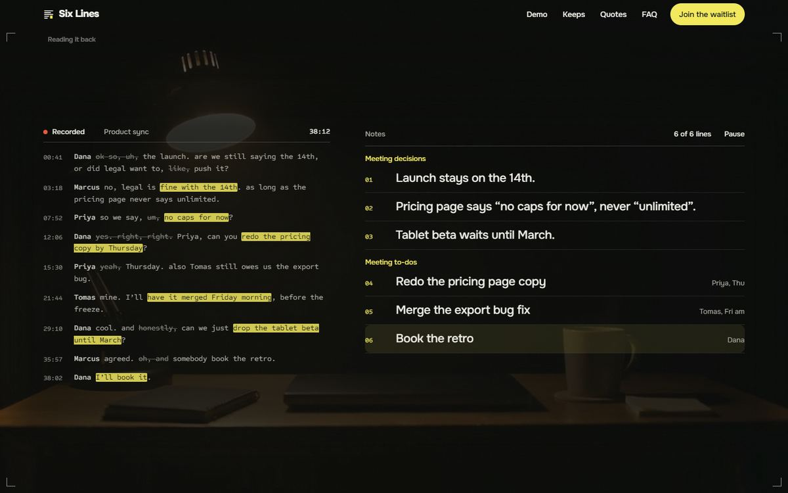

# The Site Library

**Surface:** a members' library of websites for fictional brands. It is a paid product, so this page is a write-up only. No site source, assets, or prompts from the library are in this repository.

## Job

Show what this skill produces when it is followed all the way through. Each site is a complete page for a business that does not exist, such as a subsea cable repair firm or a meeting-notes app. Members study a site's structure, motion, and method, then rebuild them for their own clients.

The library is also where this skill gets tested. Every site goes through review rounds, and what those rounds catch comes back here as rules.

## Method

1. Every build and review round starts by loading scroll-craft, taste-skill, and Hallmark, whose guidance this repository carries in `scroll.md`, `copy.md`, and `gates.md`.
2. Stand-in photographs and footage hold every slot while the page is designed. Final film and photography are made once the design holds.
3. Each round builds, runs the checks (Resolve at five widths, the screen-line recipe in `layout.md`), and hands the captures to a reviewer with no inherited context, who answers `ship` or `fix`. Fixes go in as the next round, never as edits to a round under review.
4. A site is finished when the owner has looked at it and approved it. A reviewer's `ship` does not count as approval.
5. After each batch of rounds, the lessons land in this repository as rules, in the reference where that kind of rule lives. The first batch covers type pairing, whole screens at every width, gate coverage, stand-in photography, copy cuts, token hygiene, signature feedback, depth layers, the showcase rule, and review discipline (see `CHANGELOG.md`). The second batch comes from three more sites in review, a sunglasses page with a live 3D model, a glassblowing film, and an illustrator's sketchbook: hand-overs from a still to a live model, pins on short screens, reveals that fail open, checks a browser pass should include, and forms on a fictional demo page.

Two sites are finished so far.

## Deep Line Subsea

A fictional subsea cable repair company. The page is one unbroken film, scrubbed by scroll, from a cable ship at the surface down to a cable fault 5,840 m below. The wordmark is the depth itself. It stands behind the ship through a matte cut from the film, with a hairline outline in front so it stays readable, and on scroll it sinks into the water.

What it shows:

- The grammar is the continuous world from `scroll.md`, the expensive one. It earns its cost here because the job is a descent, and a depth readout rides along the whole way.
- Scroll maps to film time in story units, so no single shot takes more than about a fifth of the pinned scroll and none races the wheel. The last frame holds, sharp and uncovered, before the report form slides up over it.
- As the camera crosses the surface there is no text at all, only the film. The silence is planned.
- Marine snow drifts by the film's playhead, so it rests where the film rests.
- The type is Big Shoulders Display, condensed and heavy, over Instrument Sans. JetBrains Mono appears only on instrument readouts (depth, pressure, temperature), which are measurements.
- When the hero mattes were recut, returning visitors kept seeing the old ones until the files got new names. The rename rule in `media.md` comes from that.

## Six Lines

A fictional meeting-notes app taking a waitlist. A muted loop of a desk under one lamp, after the call, runs behind the whole page. The headline is the moment the product exists for: the meeting ends.

What it shows:

- The demo carries the argument. The signature is a transcript that writes its own six lines: filler struck through, the phrases that matter highlighted, and decisions and to-dos filling in beside it with owners and days. It is built in HTML at full fidelity, with Pause and Replay.
- Scroll brings the demo into view and holds the stage briefly under the bar, so a fast scroll does not run past it. The demo then plays once on its own, pauses offscreen or in a hidden tab, and resumes on the same frame. Scroll never scrubs it.
- Every headline enters and leaves the same way. Each line rises out of its own mask, and each heading leaves as a ghost, dimming fast and then fading.
- Under reduced motion nothing pins and the film is replaced by its poster. The demo shows its finished state, with all six lines filled in.

## What is transferable

- a grammar chosen per site, with a reason the other grammars lost
- one signature per site, built in the page, that only this business could have
- the review loop: checks at every width the layout changes at, a reviewer with no context, fixes as the next round, the owner's own look at the end
- lessons from review folded back into the skill as rules, so the next site starts from them

## What is brand-specific

- the films, mattes, and stand-in photography
- the fictional names, copy, figures, and forms
- each site's palette, pairing, and signature

## Showcase

In the library itself, each motion site is shown as a recorded loop of its motion, never a still (`skills/cinematic-asset-gallery`). The stills on this page only illustrate this write-up.

## Do not copy

Do not lift a site's film, copy, section order, or signature into another project. The sites are references for method. A page for a real client needs its own material, grammar, and signature.
